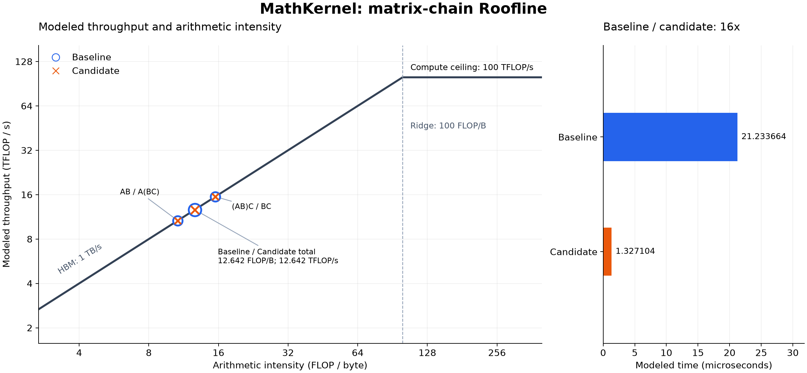

# MathKernel

为 agent 提供数学变换工作流：收集用户的计算需求与资源信息，检查任务是否完整，多轮评价和证明候选，并交付可重新验收的优化计算方案。

工作流面向已有或新的 kernel，也适用于合并与切分。用户确认数学规格、执行与成本模型、基线、目标和预算；agent 按这些依据提出候选。缺少信息时先协助用户补充，只有得到授权才能代为补充定义或假设。Lean 检查确认模型内的数学正确性、资源可行性和目标改进。

内置三矩阵链模型，并提供任务局部 Lean 模型接口与逐元素融合实例。产出包包含结构化方案、前后公式、执行伪代码、Roofline PNG、成本对比及证明材料。

## 开始使用

Python 工具使用标准库，需要 Python 3.11 或更新版本。形式化验证使用固定版本 Lean 4.24.0 和匹配的 Mathlib。

```bash
git clone https://github.com/lw-liuwang/mathkernel.git
cd mathkernel
```

在 Linux x86_64 上，使用 Python 3.14 执行本地安装：

```bash
python3 tools/setup_lean.py
```

安装脚本需要 `curl`、`git` 和 C 编译器。它下载并核对 Lean 工具链，安装到本地缓存，拉取固定版本 Mathlib 及所需模块的预编译缓存，然后构建模型。缓存默认放在项目的 `.cache/mathkernel` 中，也可以通过 `--cache-dir` 或环境变量 `TMPDIR` 指定位置。工具链下载约 440 MiB，Mathlib 还需要额外存储。

如果已有相同版本的 Lean 环境，可用 `MATHKERNEL_LAKE` 指定 `lake` 可执行文件，然后在 `lean/` 中更新依赖、获取缓存并构建。安装脚本适用于本机 Linux；其他平台需要自行准备匹配的 Lean 环境。

绘图使用 Matplotlib，安装到项目环境后，用该环境的 Python 执行工作流：

```bash
export TMPDIR="$PWD/.cache"
mkdir -p "$TMPDIR"
export UV_CACHE_DIR="$TMPDIR/uv-cache"
uv venv --python 3.13 .venv
uv pip install --python .venv/bin/python -r requirements-plot.txt
.venv/bin/python tools/mathkernel.py doctor
```

`doctor` 检查 Python、固定版本 Lean、模型构建和 PNG 导出，返回缺失项和处理建议。Lean 安装所需的 Python 3.14 与运行 CLI 的 Python 可以不同。

## 让 agent 工作

给 agent 仓库位置和计算需求：

> 阅读 `skills/optimize-mathkernel/SKILL.md`，按 `workflows/prove-improvement.md` 完成数学变换。先帮助我整理输入条件、计算资源、基线、目标与预算；缺少信息时询问我，代为补充前取得授权，补充完成后交我确认。多轮迭代后交付通过验收的优化计算方案。

主要命令从仓库根目录运行，任务目录可以放在项目以外：

```bash
.venv/bin/python tools/mathkernel.py task init /path/to/task
.venv/bin/python tools/mathkernel.py task check /path/to/task
```

也可以用 `--example matmul-chain` 或 `--example fusion` 开始，示例参数仍需用户确认。Agent 按检查结果补齐 `task.json` 和模型定义。用户确认后记录其实际决定，再提出候选：

```bash
.venv/bin/python tools/mathkernel.py task confirm /path/to/task --by '<确认人>' --note '<用户实际确认内容>'
.venv/bin/python tools/mathkernel.py task evaluate /path/to/task /path/to/candidate.json
.venv/bin/python tools/mathkernel.py task verify /path/to/task ITERATION_ID
.venv/bin/python tools/mathkernel.py task status /path/to/task
```

使用评价返回的真实迭代 ID。`evaluate` 保存尝试和模型评价，`verify` 检查完整 Lean 证明；失败可以根据日志修改候选或证明。任务依据改变后，旧确认和证据不能继续用于新任务验收。

选定符合目标的候选后：

```bash
.venv/bin/python tools/mathkernel.py task accept /path/to/task ITERATION_ID
.venv/bin/python tools/mathkernel.py task export /path/to/task ITERATION_ID --output /path/to/new-bundle
.venv/bin/python tools/mathkernel.py task accept /path/to/new-bundle
```

验收重新运行评价与证明，并生成图和报告；导出还会在独立产出目录再次验收。只有 `acceptance_status: accepted` 且退出码为 0，才能交付为已验收成果。预算内没有合格候选时，交付工作目录、已探索范围及未解决项。

输入格式、新模型接入、授权记录和验收状态见 [任务协议](docs/tasks.md)。本地与远端 CI 使用同一组命令。

## 现有三矩阵链接口

原有独立任务接口保持兼容：

```bash
python3 tools/mathkernel.py inspect examples/matmul-chain/task.json
python3 tools/mathkernel.py evaluate examples/matmul-chain/task.json examples/matmul-chain/candidate.json
python3 tools/mathkernel.py verify examples/matmul-chain/task.json examples/matmul-chain/candidate.json
python3 tools/mathkernel.py report runs/RUN_ID/result.json
```

`verify` 将输入、证明、日志和结果保存到实际返回的 `runs/` 目录；退出码为 0 且 `verification_status: verified` 表示实例通过证明。旧 `report` 仅展示已有结果。需要任务确认、迭代记录与产出包验收时，使用上面的 `task` 工作流。

## 三矩阵链的输入、输出与评价目标

任务 JSON 包含三个矩阵形状、硬件参数、固定模型名称和基线。候选 JSON 只包含结合顺序与分块：

```json
{"order": "right", "tile": {"m": 64, "n": 64, "k": 64}}
```

`left` 表示 `(AB)C`，`right` 表示 `A(BC)`。三个块共享快速存储；每次 GEMM 的维度都必须被对应块大小整除。模型及计数规则见 [docs/model.md](docs/model.md)。

优化目标是各次顺序 GEMM 的理想耗时之和：

$$
\widehat T(P;H)=\sum_g\max\left(\frac{F_g}{P_{\max}},\frac{Q_g}{B_{\max}}\right).
$$

工具分别记录计算量、显存搬运量、快速存储峰值和估计时间，使用精确整数及有理数比较。示例采用合成硬件参数。

| 示例指标 | 基线 `(AB)C` | 候选 `A(BC)` |
| --- | ---: | ---: |
| 计算量（FLOP） | 268,435,456 | 16,777,216 |
| 显存搬运（字节） | 21,233,664 | 1,327,104 |
| 快速存储峰值（字节） | 49,152 | 49,152 |
| 模型耗时 | 21.233664 µs | 1.327104 µs |

示例模型耗时比为 16。

## Roofline 图



当前示例的硬件拐点为 100 FLOP/Byte。两个方案整体都位于约 12.642 FLOP/Byte、12.642 TFLOP/s，处于带宽受限区。图中同时标出每次 GEMM 与完整方案；相同坐标用蓝色圆环和橙色叉号重叠显示。

这次重新结合将计算量和显存搬运量同时降为基线的 1/16，因此算术强度和模型吞吐率保持相同，而完成任务的模型耗时从 21.233664 µs 降至 1.327104 µs。右侧耗时图展示这个差别。

绘图依赖单独安装到项目虚拟环境：

```bash
export TMPDIR="$PWD/.cache"
mkdir -p "$TMPDIR"
export UV_CACHE_DIR="$TMPDIR/uv-cache"
uv venv --python 3.13 .venv
uv pip install --python .venv/bin/python -r requirements-plot.txt
.venv/bin/python tools/mathkernel.py roofline examples/matmul-chain/task.json examples/matmul-chain/candidate.json --output docs/figures/matmul-chain-roofline
```

命令导出 [PNG](docs/figures/matmul-chain-roofline.png) 和[坐标数据](docs/figures/matmul-chain-roofline.json)。横坐标为 FLOP/Byte，纵坐标为各方案自身运算量除以模型耗时。完整方案的耗时是各次 GEMM 耗时之和。

## 形式化验证

三矩阵链实例中，Lean 检查候选和基线对所有对应形状的实数矩阵输出相同、两个方案满足资源约束、模型耗时严格下降，以及 Python 报告计数与 Lean 成本解释器一致。证明只允许基础逻辑公理，拒绝 `sorry` 或额外假设代替结论。

数学原语、硬件参数和资源计数的定义集中在 [模型规格](docs/model.md)。

验证状态包括 `verified`、`proof_failed`、`timeout`、`unavailable`、`untrusted_proof`；输入错误返回 `invalid_input`。实现与整体设计的关系见 [逻辑图](docs/logic-map.md)。

## 开发检查

```bash
python3 -m unittest discover -s tests -v
```

测试覆盖任务补充与确认、版本变更、迭代预算、成本与容量、成功和失败证明，以及两个模型的产出包导出和独立验收。在绘图环境中执行相同命令，还会检查 PNG 导出。没有对应依赖时，相关集成检查会显式跳过。

## 许可证

[MIT](LICENSE)
