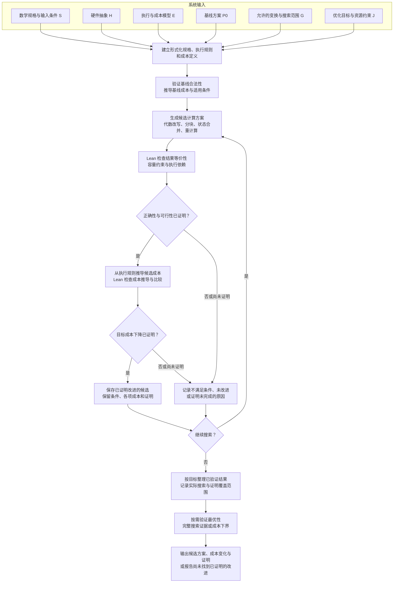
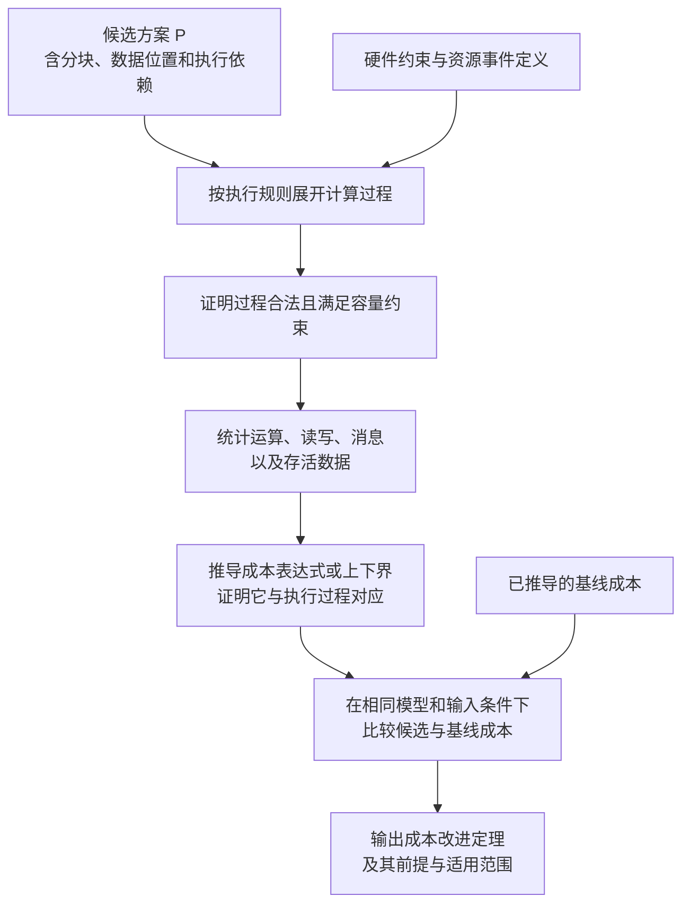

# 数学变换系统逻辑图

本系统面向 kernel 开发的数学变换阶段：给定数学定义、输入条件和硬件抽象，寻找计算组织方式不同的等价方案，并证明它们在指定模型下的资源成本变化。本文描述系统设计与证明义务。

当前实现提供通用任务工作流，内置三矩阵链模型，并以逐元素融合作为任务局部 Lean 模型实例。任务检查、用户确认、多轮记录和产出包验收共用同一工具接口，见 [任务协议](tasks.md)。公共耗时工具采用各次顺序操作的两级存储 Roofline 模型；通信与最优性仍是需要额外规则和证据的扩展方向。

第一阶段以实数上的精确等价为目标。输出是带有执行结构、适用条件和证明的数学计算方案，供后续 kernel 实现使用。

## 1. 系统输入

| 输入 | 必须明确的内容 | 用途 |
| --- | --- | --- |
| 数学规格 S | 算子定义、张量形状、输入取值范围、数值语义 | 定义哪些输出算正确，以及定理成立的条件 |
| 硬件抽象 H | 计算原语、存储层级与容量、设备及互连拓扑 | 约束候选方案，参与分块、状态表示和设备划分的选择 |
| 执行与成本模型 E | 原子操作的执行规则；各层读写、消息传输、存储占用的计量规则 | 从计算过程推导资源成本 |
| 基线方案 P0 | 原公式的具体计算顺序、数据放置、输入初始位置、输出最终位置 | 提供可复核的比较对象 |
| 搜索空间 G | 允许的变换规则、计算原语、分块和划分范围，是否允许重计算 | 定义候选来源及最优性结论的范围 |
| 优化目标 J | 优化哪个指标，其他指标的约束；必要时指定权重与输入规模范围 | 决定怎样判断改进、怎样比较不同取舍 |

硬件信息整理为模型参数与执行规则。例如，“片上存储容量为 M”形成容量约束，计算吞吐和存储带宽进入时间模型。

形状等参数既可以固定，也可以保留为符号。若改进只在 n > k 时成立，输出必须保留这个条件。

## 2. 总体处理流程

流程中的候选生成和证明验证分工不同。候选可以由规则搜索、符号推导或大模型提出；进入已验证结果的方案必须通过对应证明检查。硬件约束参与候选生成，也参与后续的可行性验证。

搜索记录包括停止原因、已覆盖的候选空间，以及各候选的证明状态。

## 3. 中间表示：公式加上计算组织方式

访存和通信取决于数据怎样被计算、保存和传递，因此候选 P 至少需要表达：

- 运算、张量形状、依赖关系，以及归约或状态合并的规则。
- 分块、执行顺序和并行划分。
- 中间结果的存储位置与存活区间，哪些结果保存、哪些重新计算。
- 数据的初始分布、设备间消息及输出的最终位置。

例如，同一个 y = (x + a) * b，可以保存完整中间数组，也可以逐元素计算并把临时值保存在寄存器里。数学输出相同，数据搬运量不同。

计算方案的执行语义需要同时描述结果与资源事件：

$$
\operatorname{Exec}_E(P,x;H)=(y,\tau),
$$

其中 y 是结果，τ 是读写、运算、通信和存储分配等事件组成的执行记录。并行方案通过依赖关系表达调度与重叠。

## 4. 如何证明成本更低

### 4.1 先定义计数规则，再推导成本

成本可以保留为资源向量：

$$
\mathbf C(P,x;H,E)
=\left(A,\{D_\ell\},\{Q_e\},R,\{S_\ell\}\right).
$$

| 符号 | 含义 | 计数依据 |
| --- | --- | --- |
| A | 各类算术操作的次数 | 按操作类型统计，明确乘法、加法、FMA 等的计数约定 |
| Dℓ | 跨第 ℓ 个存储边界的数据搬运量 | 从对应读写事件累计元素数或字节数 |
| Qe | 经过互连链路 e 的通信量 | 按消息大小及路由累计，明确多跳和广播的计数方式 |
| R | 通信或同步轮次 | 根据执行依赖与轮次定义推导 |
| Sℓ | 第 ℓ 层的峰值存储占用 | 对各时刻仍存活的数据求和，再取最大值 |

容量约束通常表现为 Sℓ ≤ H 中相应层的可用容量。存储占用和数据搬运量是不同指标，需要分别推导。

成本证明从执行规则推导资源计数，再比较候选与基线的成本表达式。

### 4.2 成本比较的证明义务

对输入域 D 内的输入 x，需要证明：

$$
\begin{aligned}
\operatorname{Result}_E(P,x)&=S(x),\\
\operatorname{Feasible}_E(P,x;H)&=\mathrm{true},\\
J(\mathbf C(P,x;H,E))&<J(\mathbf C(P_0,x;H,E)).
\end{aligned}
$$

基线 P0 满足相同规格、边界条件和资源约束。使用成本界时，以“候选成本上界小于基线成本下界”证明改进。

计算、访存和通信可以存在取舍。系统输出各项变化，再依据 J 判断是否接受。例如，可以最小化显存搬运量，同时约束计算量和片上存储占用。

若 J 是加权成本或耗时估计，在规格中明确权重、单位及并行重叠规则。公共时间工具选择各次顺序操作的 Roofline 理想耗时之和；任务也可明确优化 FLOP、搬运量或存储峰值。

### 4.3 示例：矩阵乘法改写减少计算

设 A 的形状为 n × k，B 为 k × n，C 为 n × k，且 n > k > 0。比较：

$$
P_0=(AB)C,\qquad P=A(BC).
$$

在实数语义下，结合律保证输出相同。采用普通逐项乘加算法，一个 a × b 矩阵与 b × c 矩阵相乘需要 abc 次标量乘法，因此：

$$
\begin{aligned}
A_{\mathrm{mul}}(P_0)&=2n^2k,\\
A_{\mathrm{mul}}(P)&=2nk^2,\\
A_{\mathrm{mul}}(P_0)-A_{\mathrm{mul}}(P)
&=2nk(n-k)>0.
\end{aligned}
$$

这证明了标量乘法次数减少。完整保存中间矩阵时，中间结果的元素数从 n² 变为 k²，总访存量根据执行方式推导。

### 4.4 示例：融合减少显存搬运

对长度 N > 0 的数组计算 yᵢ = (xᵢ + aᵢ)bᵢ。假设三个输入数组互不别名、取值任意且最初位于显存，输出需要完整写入显存中的独立缓冲区。模型以元素为搬运单位，忽略缓存：保存的中间数组必须写入并从显存读取，寄存器临时值不产生显存搬运，且不发生寄存器溢出到显存。

| 方案 | 显存读取 | 显存写入 | 总搬运量 |
| --- | --- | --- | --- |
| 先计算 t = x + a，再计算 y = t * b | x、a、t、b，共 4N | t、y，共 2N | 6N |
| 逐元素融合，临时值留在寄存器 | x、a、b，共 3N | y，共 N | 4N |

由执行规则推导出以上成本后，证明 6N − 4N = 2N > 0，即证明新方案在该模型下减少显存搬运。

通信成本采用同样的证明结构：明确初始数据分布、设备划分、消息和路由，再按约定统计消息数量、传输量与轮次。

## 5. 怎样证明最优

对固定规格、输入规模、硬件与成本模型，令合法候选集合为 𝒫，并用 K(P) 表示所选目标下的方案成本。例如，可以选择最坏情况显存搬运量作为 K。最优性要求证明：

$$
P^*\in\mathcal P,\qquad
\forall P\in\mathcal P,\quad K(P^*)\le K(P).
$$

这比证明优于基线更强。系统需要区分以下结论：

| 结论 | 必须提供的证据 |
| --- | --- |
| 优于基线 | 等价、可行，以及目标成本严格下降的证明 |
| 已验证候选中的最佳方案 | 对已通过验证的候选完成成本比较；明确未覆盖的候选 |
| 指定搜索空间内最优 | 对该空间的完整覆盖证明（可含正确剪枝）、各合法候选的成本依据，以及最小值比较 |
| 达到理论下界 | 对所有允许方案都成立的成本下界，以及候选达到该下界的证明 |

完整搜索证据覆盖整个声明的空间，并记录各候选的合法性、成本比较和证明状态。

下界匹配通过算法类别、存储和通信模型限定范围。同阶匹配对应渐近最优；精确匹配对应精确成本最优。

例如，在上面的数组模型中，可以进一步证明：最坏情况下必须读取全部三个输入并写出完整输出，搬运下界为 4N。取所有输入元素均为 1；若有输入元素未被读取，就可以只改变该元素，使正确输出发生变化，而执行过程无法区分这两个输入。融合方案达到该下界，可得到该模型下最坏情况显存搬运量最优的结论。

## 6. 系统输出

每个接受的候选需要携带：

1. 原始规格、变换后的数学表示及足以推导成本的执行结构。
2. 输入形状、取值范围、硬件容量、初始及最终数据位置等适用条件。
3. 正确性、资源可行性、成本推导与成本比较的证明产物。
4. 基线与候选的各项资源成本，说明改善的指标和付出的代价。
5. 搜索与证明覆盖范围，以及实际取得的最优性等级。

若没有通过验证的改进，输出当前状态、诊断和搜索范围。通过验证的结果连同规格与证明产物交付后续 kernel 开发。

## 7. Lean 的职责与证明边界

Lean 检查形式化规格、执行语义和成本模型内的证明，包括结果等价、容量与依赖约束、资源计数、成本不等式，以及具备证据时的最优性定理。候选生成器和搜索器可以独立实现，Lean 负责检查它们提交的证明。

成本计数规则、硬件抽象和定理前提保存在规格中，输出保留对应证明依赖。

第一阶段的成功标准是：对一个具体算子，产生至少一种数学上等价、资源上可行的计算表示，并给出从执行规则到资源成本下降的完整证明链。全局最优作为需要额外覆盖证据或下界证明的独立目标。
